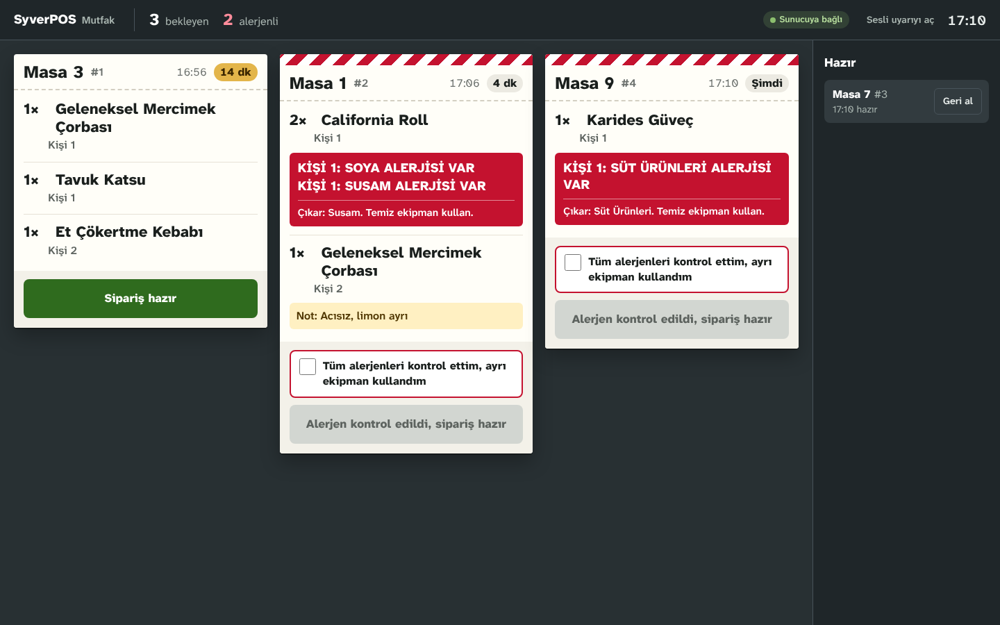
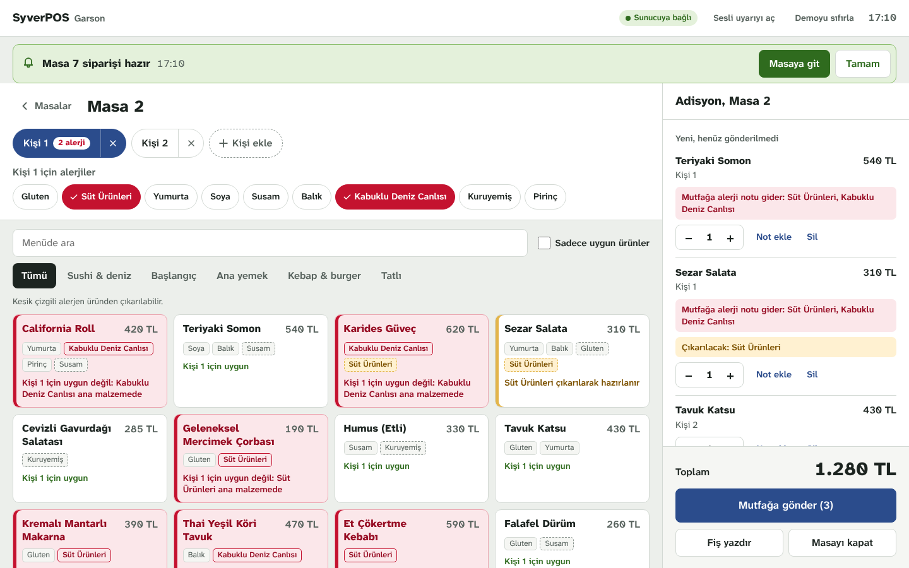
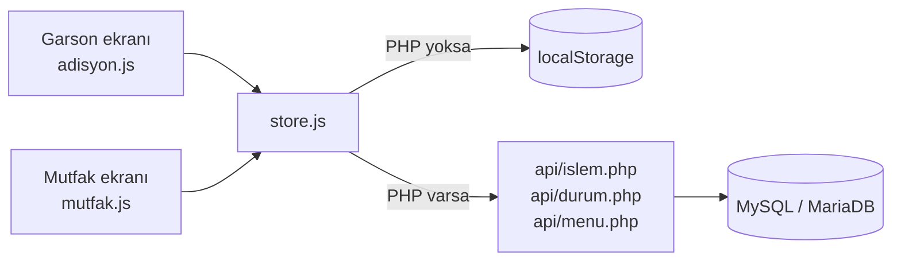
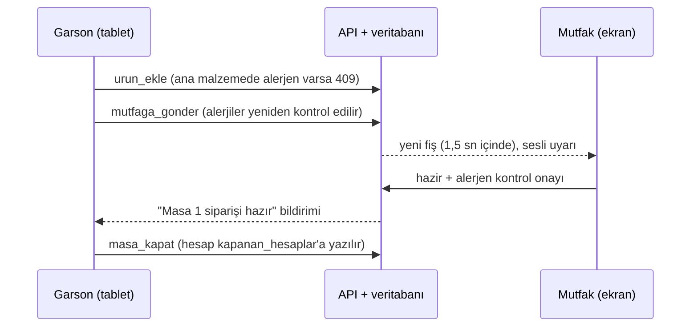

# SyverPOS

Alerjen kontrollü restoran adisyon sistemi. Garson misafirin alerjisini girer, sistem riskli ürünü engeller, mutfak alerjeni onaylamadan sipariş hazır olmaz.

**Canlı demo:** https://elifyrlkya10-boop.github.io/syverpos/
Garson ve mutfak ekranı aynı sayfada yan yana açılır, kurulum gerekmez.



## Neden?

Bir suşi restoranında mutfakta çalışıyorum. Alerji bilgisi garsondan mutfağa çoğu zaman sözlü ya da fişe el yazısıyla geçiyor ve yoğun saatte gözden kaçabiliyor. SyverPOS bu bilgiyi siparişin parçası yapar: alerji kişiye bağlanır, ürünle karşılaştırılır ve mutfakta görmezden gelinemeyecek şekilde gösterilir.

## Özellikler

**Garson ekranı**
- Masa planı: boş, açık, mutfakta ve hazır masalar renkle ayrılır; alerjili misafiri olan masa işaretlenir.
- Kişi bazlı sipariş: her misafirin alerjileri ayrı seçilir.
- Ana malzemesinde alerjen olan ürün **eklenemez**. Çıkarılabilir malzemede alerjen varsa ürün eklenir, mutfağa "çıkar" notu gider.
- Alerji ürün eklendikten **sonra** işaretlense bile sistem satırı yakalar ve mutfağa gönderilmesine izin vermez. Fiş mutfağa gittikten sonra işaretlenen alerji de mutfak ekranındaki fişe yansır ve "hazır" için aşçı onayı ister.
- Alerjiyi kaldırmadan önce garsondan onay istenir.
- "Sadece uygun ürünler" filtresi, satır notu (hızlı notlarla), 80 mm fiş çıktısı.
- Mutfak "hazır" deyince "Masa 3 siparişi hazır" bildirimi ve isteğe bağlı sesli uyarı.
- Tablet ve telefonda kullanılabilir.

**Mutfak ekranı**
- Her "Mutfağa gönder" bir fiş olur, fişler eskiden yeniye sıralanır.
- Alerjenli fişin üstünde kırmızı-beyaz şerit; her alerjen ayrı satırda: `KİŞİ 1: SOYA ALERJİSİ VAR`.
- Alerjenli fişte "hazır" düğmesi, aşçı kontrol kutusunu işaretlemeden açılmaz.
- Bekleme süresi sayacı (10 dakikayı geçen fiş sarıya döner), garson notları, yanlışlıkla "hazır" denen fiş için geri alma.

**Sunucu (PHP + MySQL)**
- Garson tableti, garson telefonu ve mutfak ekranı farklı cihazlarda aynı anda çalışır.
- Alerjen kuralları sunucuda da kontrol edilir. Tarayıcıdaki kontrol atlatılsa bile uygun olmayan ürün eklenemez, alerjenli fiş onaysız hazır yapılamaz.
- Her işlem bir veritabanı işlemi (transaction) içinde çalışır; aynı anda gelen istekler birbirini bozmaz.
- Menü ve fiyatlar veritabanından okunur. phpMyAdmin'den fiyat değişince ekranda da değişir.
- Kapatılan masaların hesabı `kapanan_hesaplar` tablosuna yazılır.



## İki çalışma modu

Aynı dosyalar iki şekilde çalışır. Ekran açılırken `api/` klasörüne ulaşmayı dener ve modu kendisi seçer. Hangi modda olduğu üst çubukta yazar.

| | Demo modu | Sunucu modu |
|---|---|---|
| Nerede? | GitHub Pages, dosyaya çift tıklama | XAMPP ya da PHP çalıştıran herhangi bir sunucu |
| Veri | Tarayıcının `localStorage`'ı | MySQL / MariaDB |
| Cihazlar | Aynı tarayıcıdaki sekmeler | Aynı ağdaki bütün cihazlar |
| Üst çubukta | Demo modu | Sunucuya bağlı |



## Çalıştırma

### Demo modu (kurulum yok)

[Canlı demoyu](https://elifyrlkya10-boop.github.io/syverpos/) aç ya da repoyu indirip `index.html` dosyasını Chrome veya Edge ile aç.

### Sunucu modu (XAMPP)

1. [XAMPP](https://www.apachefriends.org/) kurulu değilse kur.
2. Repo klasörünü `C:\xampp\htdocs\syverpos` olacak şekilde kopyala.
3. XAMPP Control Panel'de **Apache** ve **MySQL**'i başlat.
4. `http://localhost/phpmyadmin` → **İçe Aktar** → `database/syverpos_db.sql` dosyasını seç → **Git**.
5. Tarayıcıda `http://localhost/syverpos/` adresini aç. Üst çubukta **Sunucuya bağlı** yazmalı.

MySQL 3306 ya da 3307 portundaysa ayar gerekmez. Farklı port ya da root şifresi kullanıyorsan `api/config.php` dosyasını düzenle.

**Diğer cihazlardan bağlanmak (tablet, telefon, mutfak ekranı):**

1. Cihazlar bilgisayarla aynı Wi-Fi ağında olmalı.
2. Bilgisayarda `cmd` aç, `ipconfig` yaz, **IPv4 Adresi**'ni not al (ör. `192.168.1.34`).
3. Tablette `http://192.168.1.34/syverpos/adisyon.html`, mutfak ekranında `http://192.168.1.34/syverpos/mutfak.html` adresini aç.
4. Windows Güvenlik Duvarı Apache için izin sorarsa **Özel ağlar** için izin ver.

## Alerjen kuralı

Her ürün–alerjen ilişkisi veritabanında iki türden biridir:

| `cikarilabilir` | Anlamı | Sistem ne yapar? |
|---|---|---|
| `0` | Ana malzeme (ör. Teriyaki Somon'daki soya) | Ürün o kişiye eklenemez |
| `1` | Çıkarılabilir (ör. California Roll'daki susam) | Ürün eklenir, mutfağa "Çıkar: Susam" yazılır |

Misafirin alerjisi üründe hiç yoksa bile fişe alerji notu düşer, çünkü mutfakta çapraz bulaşma riski vardır.

## Akış



## Proje yapısı

```
syverpos/
├── index.html             Giriş sayfası, iki ekranı yan yana gösterir
├── adisyon.html           Garson ekranı
├── mutfak.html            Mutfak ekranı
├── assets/
│   ├── css/style.css      Tüm stiller
│   ├── js/data.js         Demo modu için menü verisi (SQL ile aynı)
│   ├── js/common.js       Alerjen hesabı, biçimlendirme, pencere, ses
│   ├── js/store.js        Veri katmanı: mod seçimi, localStorage ve API
│   ├── js/adisyon.js      Garson ekranı
│   ├── js/mutfak.js       Mutfak ekranı
│   └── fonts/             Atkinson Hyperlegible Next (OFL lisansı)
├── api/
│   ├── config.php         Veritabanı ayarları
│   ├── db.php             Bağlantı ve ortak fonksiyonlar
│   ├── menu.php           GET: menü ve alerjenler
│   ├── durum.php          GET: masalar, fişler, bildirimler
│   └── islem.php          POST: bütün değişiklikler ve iş kuralları
├── database/
│   └── syverpos_db.sql    Şema ve örnek veri
└── docs/
    ├── API.md             API'nin işlem listesi ve örnekleri
    ├── KOD_ANLATIMI.md    Sunum için kodun bölüm bölüm anlatımı
    └── ekran-goruntuleri/
```

## Teknik notlar

- **Ön yüz:** saf HTML, CSS ve JavaScript. Kütüphane ya da derleme adımı yok. Dosyaya çift tıklayınca da çalışması için ES modülleri yerine klasik `<script>` etiketleri kullanıldı.
- **Arka uç:** saf PHP (7.4+) ve PDO. Bütün sorgular hazırlanmış ifadelerle (prepared statements) çalışır.
- **Tek kapı:** ekranlar veriyi doğrudan değiştirmez; `urun_ekle`, `mutfaga_gonder`, `hazir` gibi adı olan işlemler çağırır. Aynı işlemler demo modunda `store.js` içinde, sunucu modunda `api/islem.php` içinde aynı kurallarla çalışır. Liste: [docs/API.md](docs/API.md).
- **Eşzamanlılık:** her işlem önce `sistem` tablosundaki sürüm sayacını artırır. Bu satır kilidi aynı anda gelen işlemleri sıraya sokar. Test: 12 paralel "ürün ekle" isteği tek satırda adet 12 olarak kaydedildi; 4 paralel "mutfağa gönder" isteğinden yalnızca biri fiş oluşturdu.
- **Güncelleme:** ekranlar 1,5 saniyede bir sürüm numarasını sorar. Değişiklik yoksa sunucu sadece `{"degismedi": true}` döner.
- **Fiş anlık görüntüdür:** `fis_kalemleri` tablosu gönderim anındaki kişi adı ve alerjileri saklar. Sonradan değişse bile mutfağa ne söylendiği kayıtta kalır.
- **Okunabilirlik:** yazı tipi, harfleri birbirine karışmayan Atkinson Hyperlegible Next. Kırmızı renk yalnızca alerjen için kullanılır.

## Yol haritası

- [x] PHP API ve MySQL ile farklı cihazlar arası çalışma
- [ ] Anlık bağlantı (WebSocket) ile 1,5 saniyelik gecikmenin kaldırılması
- [ ] Menü ve alerjen yönetimi için yönetici ekranı
- [ ] `kapanan_hesaplar` tablosundan günlük satış raporu
- [ ] Mutfakta istasyona göre ayrım (sushi bar, sıcak, soğuk, tatlı)
- [ ] Garson girişi ve yetkilendirme

## Geliştiren

**Elif Nur Yerlikaya**
İstanbul Arel Üniversitesi, Bilgisayar Programcılığı bitirme projesi.

---

### English summary

SyverPOS is a restaurant point-of-sale system with allergen safety built in. The waiter records each guest's allergies; dishes whose main ingredient contains an allergen cannot be ordered, and removable ingredients are flagged for the kitchen. The kitchen display shows every allergen in a high-contrast block and will not mark an allergen ticket as ready until the cook confirms the check.

The same front end runs in two modes. Without a server (GitHub Pages) it keeps data in `localStorage`. With PHP and MySQL (e.g. XAMPP) waiters' tablets and the kitchen screen run on separate devices; every change goes through a small PHP API that re-validates the allergen rules inside a database transaction. Plain HTML, CSS and JavaScript; PHP 7.4+ with PDO; MariaDB/MySQL schema in `database/syverpos_db.sql`. [Live demo](https://elifyrlkya10-boop.github.io/syverpos/).
